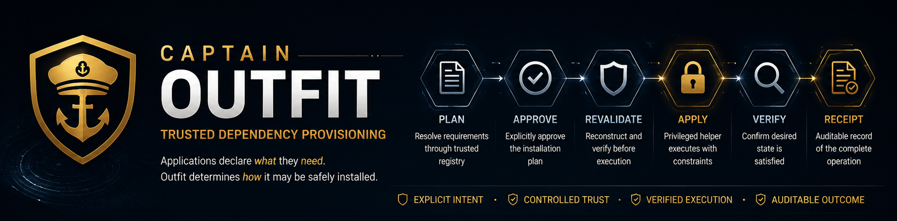

# Captain Outfit
<p align="center">
    
</p>
> Trusted operating-system dependency provisioning with explicit planning, approval, verification, and privileged execution.

Captain Outfit is a dependency provisioning tool designed around a simple principle:

**Applications should be able to declare what they need without being trusted to decide how privileged software is installed.**

Instead of allowing application manifests, build scripts, or arbitrary package names to cross the privilege boundary directly, Outfit resolves logical dependency requirements through a trusted registry, constructs an installation plan, requires explicit approval, revalidates that plan immediately before execution, and verifies the resulting system state.

```text
Application Manifest
        │
        │ logical requirements
        ▼
┌──────────────────────┐
│        Outfit        │
│                      │
│  Resolve             │
│  Plan                │
│  Approve             │
│  Revalidate          │
└──────────┬───────────┘
           │
           │ approved execution request
           ▼
┌──────────────────────┐
│ Privileged Helper    │
│                      │
│ Reconstruct          │
│ Verify               │
│ Execute              │
│ Verify Again         │
└──────────┬───────────┘
           │
           ▼
      Host Package
        Manager
           │
           ▼
        Receipt
```

## Why Outfit Exists

Installing a system dependency looks simple:

```bash
sudo apt install some-package
```

But once dependency installation becomes automated, several questions appear:

- Who decided that `some-package` is the correct package?
- Which repository is authorized to provide it?
- Is that mapping valid for this operating system?
- Is the package manager trusted on this host?
- Did the dependency mapping change after the user reviewed it?
- Did the installation plan change after approval?
- What exactly crossed the privilege boundary?
- Can the resulting operation be verified afterward?

Outfit treats those questions as part of dependency management rather than as somebody else's security problem.

## The Outfit Model

An application declares a **logical dependency**:

```json
{
  "requires": [
    "utility.sl"
  ]
}
```

It does **not** declare:

```text
apt install sl
```

It does not select a repository.

It does not construct a privileged shell command.

Instead, Outfit resolves `utility.sl` through the trusted Captain Outfit Registry.

A registry mapping can describe:

```json
{
  "id": "utility.sl",
  "mappings": [
    {
      "platform": "ubuntu",
      "packageManager": "apt",
      "package": "sl",
      "source": "ubuntu.official"
    }
  ]
}
```

The application describes **what it requires**.

The registry determines **how that requirement may be satisfied**.

Outfit determines **whether the resulting operation is valid for the current host**.

---

# Trusted Apply Lifecycle

Outfit deliberately separates dependency installation into distinct stages.

```text
        PLAN
          │
          ▼
       APPROVE
          │
          ▼
      REVALIDATE
          │
          ▼
        APPLY
          │
          ▼
        VERIFY
          │
          ▼
       RECEIPT
```

The approval is not permission to execute arbitrary future state.

It is approval of a **specific effective plan**.

If the plan, manifest, registry mapping, or resulting transaction changes, Outfit rejects the operation.

## 1. Plan

Create an installation plan:

```bash
outfit plan \
  --manifest examples/outfit-demo.json \
  --registry ../captain-outfit-registry \
  --output outfit.plan.json
```

Outfit:

1. detects the host,
2. identifies a verified package manager,
3. loads and verifies the registry,
4. resolves logical dependencies,
5. previews the native package transaction,
6. normalizes the resulting installation plan, and
7. writes the plan artifact.

Nothing is installed.

## 2. Approve

Approve the generated plan:

```bash
outfit approve \
  --plan outfit.plan.json \
  --output outfit.approval.json
```

The approval binds to the plan fingerprint.

It records the approved:

- plan,
- registry version,
- platform,
- package manager, and
- cryptographic fingerprint.

Approval therefore represents:

> **I approve this plan.**

Not:

> **I approve whatever this tool decides to do later.**

## 3. Apply

Apply the approved plan:

```bash
outfit apply \
  --manifest examples/outfit-demo.json \
  --registry ../captain-outfit-registry \
  --plan outfit.plan.json \
  --approval outfit.approval.json
```

Before privileged execution, Outfit reconstructs the operation from current trusted inputs and compares it against the approved state.

If anything material changed, execution stops.

For example:

```text
Outfit apply failed.

Reason:
  Approved plan fingerprint does not match current plan
```

No package-manager operation occurs.

## 4. Verify

Successful native execution is not considered sufficient by itself.

Outfit verifies the resulting installation state and reconstructs the desired state again.

Only when the expected state is satisfied is the operation considered successful.

## 5. Receipt

Executed operations produce a root-owned receipt under:

```text
/var/lib/captain/outfit/receipts/
```

Receipts are written with private permissions and provide an audit artifact describing the operation and verification result.

Example:

```text
-rw------- 1 root root ... <receipt-id>.json
```

---

# Idempotent Apply

If the requested dependencies are already present, Outfit recognizes that the desired state has already been reached.

Running `apply` again produces:

```text
Outfit is already satisfied.

No changes were required.

Receipt:
  /var/lib/captain/outfit/receipts/<receipt-id>.json
```

Outfit distinguishes between:

```text
successful execution
```

and:

```text
desired state already satisfied
```

That distinction is intentional.

---

# The Privilege Boundary

The public `outfit` CLI does not receive unrestricted root privileges.

Privileged execution crosses a narrow helper boundary:

```text
/usr/bin/outfit
       │
       │ sudo
       ▼
/usr/lib/captain/outfit/outfit-helper
       │
       ▼
 verified native execution
```

The sudo policy grants elevation only to the installed Outfit helper.

It does **not** grant Outfit users unrestricted elevated access to the native package manager through the Outfit policy.

The helper:

- reconstructs the execution request,
- validates the approved plan,
- validates package input,
- builds the native operation internally,
- executes without a shell,
- verifies the resulting state, and
- writes the execution receipt.

The privileged boundary therefore receives a constrained, validated operation rather than arbitrary shell instructions.

---

# Registry Trust

Outfit does not blindly trust a registry file simply because a path was supplied.

Registry releases are protected by:

- SHA-256 content integrity,
- signed release metadata,
- Ed25519 signatures,
- trusted signing-key identifiers, and
- locally installed trust anchors.

The host trust store lives at:

```text
/etc/captain/outfit/trust/
```

A registry whose contents have been modified without a corresponding valid trusted release signature is rejected.

Trust originates from the host — not from the application requesting installation.

---

# Security Properties

The current Outfit architecture is designed to enforce several boundaries.

### Applications cannot choose arbitrary package sources

Logical dependencies must resolve through registered mappings.

### Sources are constrained by platform and package manager

A registered source cannot automatically be used everywhere.

### Package managers must be detected and verified

Finding an executable with a familiar name is not sufficient.

### Approval is cryptographically bound to the effective plan

Changing the approved transaction changes its fingerprint.

### Current state is reconstructed before execution

The privileged helper does not simply trust artifacts handed to it.

### Package names are validated before native execution

Shell syntax and malformed package requests are rejected.

### Native execution does not use a shell

The helper invokes the expected executable directly with validated arguments.

### Registry integrity is verified

Modified registry content, invalid signatures, unknown signing keys, and untrusted key material are rejected.

### Execution is verified afterward

A successful package-manager exit code alone does not prove the desired state was reached.

---

# Host Detection

Outfit currently detects Linux distribution and package-manager information including:

```text
OS
Architecture
Distribution
Distribution family
Available package managers
Verified package managers
Selected package manager
Package-manager version
```

Example Ubuntu host:

```text
linux
x64
Ubuntu 22.04
Debian family
apt
```

---

# Current Platform Support

The first execution backend targets:

**Ubuntu / Debian-family systems using APT.**

The architecture intentionally separates:

- host detection,
- registry resolution,
- planning,
- package-manager adapters,
- approval,
- privileged execution, and
- post-execution verification.

Additional package managers and platforms can therefore be added without changing the core trust model.

---

# CLI

```text
outfit detect
outfit host
outfit plan
outfit approve
outfit apply
```

Common options:

```text
--json
--verbose, -v
--quiet, -q
--help, -h
--version
```

Get help:

```bash
outfit --help
```

Machine-readable output is available with:

```bash
outfit <command> --json
```

---

# Development

Requires Node.js and npm.

Clone the repository and install dependencies:

```bash
npm install
```

Build:

```bash
npm run build
```

Run the test suite:

```bash
npm test
```

The current test suite covers the trust and execution lifecycle, including:

- host detection,
- package-manager selection,
- dependency resolution,
- source authorization,
- APT transaction parsing,
- plan normalization,
- plan fingerprinting,
- approval validation,
- manifest-change detection,
- registry-change detection,
- helper reconstruction,
- execution-request validation,
- registry integrity,
- Ed25519 release signatures,
- trusted signing keys,
- native executable validation,
- execution receipts, and
- post-execution verification.

---

# Development Installation

The repository includes a development installer:

```bash
./scripts/install-dev.sh
```

It installs the development runtime into the system locations used by Outfit, including:

```text
/usr/bin/outfit
/usr/lib/captain/outfit/
/etc/captain/outfit/trust/
/etc/sudoers.d/captain-outfit
```

The installer validates the sudoers policy before and after installation.

---

# Design Philosophy

Outfit is not intended to become another syntax for:

```text
sudo apt install ...
```

Its purpose is to create a controlled relationship between:

```text
application intent
        │
        ▼
trusted dependency identity
        │
        ▼
authorized platform mapping
        │
        ▼
reviewable installation plan
        │
        ▼
explicit approval
        │
        ▼
privileged reconstruction
        │
        ▼
verified execution
        │
        ▼
auditable result
```

The application gets to say:

> **I need this capability.**

It does not automatically get to say:

> **Run this command as root.**

That distinction is the foundation of Captain Outfit.

---

# Project Status

Captain Outfit is currently under active development.

The Ubuntu/APT path implements the core trusted lifecycle:

```text
detect
  ↓
resolve
  ↓
plan
  ↓
approve
  ↓
revalidate
  ↓
privileged execution
  ↓
verify
  ↓
receipt
```

The project is still pre-release and its interfaces may change as additional platforms, package managers, registry capabilities, and Captain ecosystem integrations are introduced.

---

## Captain

**Outfit** is part of the Captain toolchain: infrastructure tooling built around explicit contracts, controlled trust boundaries, reproducible operations, and inspectable system state.