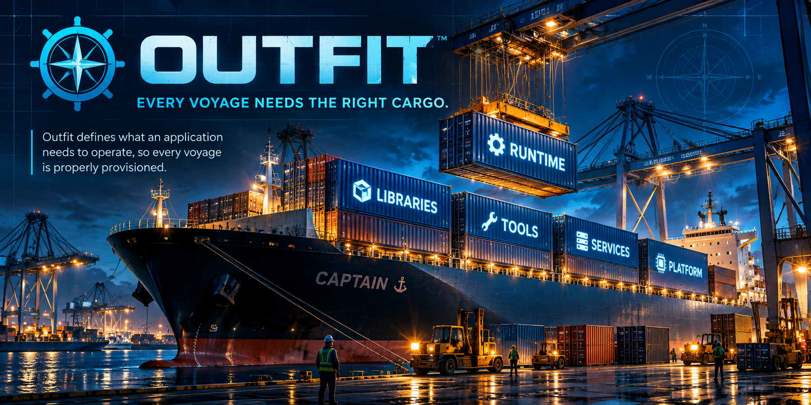

# Outfit

<p align="center">
  
</p>

**Every voyage needs the right cargo.**

Outfit helps an application declare the operating-system capabilities it needs, then safely determines how those requirements can be satisfied on a host. Instead of letting an application run arbitrary privileged installation commands, Outfit uses a **trusted dependency registry**, a **reviewable installation plan**, **explicit approval**, and **verification after execution**.

> **In one sentence:** Your application says *what it needs*; Outfit decides *what may be installed*, asks for approval, and checks the result.

**Current status:** Active development (`0.1.0-dev.0`). The documented trusted execution path targets **Ubuntu/Debian-family systems using APT**. Additional platforms and package managers are future work. Interfaces may change.

## How it works

```text
Application requirements
        ↓
Trusted registry mapping
        ↓
PLAN → review → APPROVE
        ↓
Revalidate approved request
        ↓
Privileged helper → native package manager
        ↓
Verify installed state → receipt
```

Think of a ship being loaded: applications list the cargo they need, Outfit checks the approved manifest against trusted cargo records, and only then allows the host to receive it.

## Quick start: explore safely

**Prerequisites:** Linux, Node.js 20 or later, npm. These introductory commands inspect the host and do not install OS packages.

```bash
# Clone the project and build the CLI
git clone https://github.com/captain-cli/outfit.git
cd outfit
npm install
npm run build

# See available commands
node dist/cli.js --help

# Inspect the host
node dist/cli.js detect
```

For machine-readable output:

```bash
node dist/cli.js detect --json
```

> **Safe starting point:** `detect` only reports host information. The later `plan` step previews a native package-manager transaction but does not install packages. `apply` is the privileged operation; review the generated plan and understand the registry trust setup before using it.

## Your first dependency declaration

Outfit works with **logical dependency identifiers**, not arbitrary package-install commands. The repository includes [`examples/outfit-demo.json`](./examples/outfit-demo.json):

```json
{
  "requires": ["utility.sl"]
}
```

A trusted registry can map `utility.sl` to a package for an authorized platform and source, for example:

```json
{
  "id": "utility.sl",
  "mappings": [
    {
      "platform": "ubuntu",
      "packageManager": "apt",
      "package": "sl",
      "source": "ubuntu.official"
    }
  ]
}
```

**The application does not choose the repository or construct a `sudo apt install` command.** Outfit resolves the identifier through verified registry data and the current host environment.

## Plan, approve, apply

The following workflow requires a **separately available, trusted Captain Outfit Registry** at `../captain-outfit-registry`. That directory is not created by cloning Outfit; it must contain an appropriately signed registry and the host must have its trusted signing keys configured. See [Registry trust](#registry-trust) before attempting this workflow.

### 1. Plan — no installation

```bash
node dist/cli.js plan \
  --manifest examples/outfit-demo.json \
  --registry ../captain-outfit-registry \
  --output outfit.plan.json
```

Outfit detects the host, checks the registry, resolves the logical requirements, and previews the native transaction. **Review `outfit.plan.json` before approving it.** A plan may fail when required sources, signatures, keys, or compatible package-manager support are unavailable; it does not bypass those checks.

### 2. Approve — bind approval to that plan

```bash
node dist/cli.js approve \
  --plan outfit.plan.json \
  --output outfit.approval.json
```

Approval records a cryptographic fingerprint of the effective plan. It is not blanket authorization for later changes.

### 3. Apply — privileged operation

**Do not run this until the trusted registry, host trust anchors, and Outfit's privileged helper/sudo policy have been installed and reviewed.** The project provides a development installer, discussed below.

With the installed `outfit` command and helper:

```bash
outfit apply \
  --manifest examples/outfit-demo.json \
  --registry ../captain-outfit-registry \
  --plan outfit.plan.json \
  --approval outfit.approval.json
```

Before making changes, Outfit reconstructs and revalidates the requested operation against the approved plan. If anything material changed, it rejects the request instead of executing it.

### 4. Verify and receipt

After a successful apply, Outfit checks the installed state and produces an auditable, root-owned receipt under:

```text
/var/lib/captain/outfit/receipts/
```

When a dependency is already satisfied, Outfit can report that no change was needed; this is distinct from a new installation.

## What the commands do

| Command | Purpose | Changes OS packages? |
| --- | --- | --- |
| `outfit --help` | Print CLI commands and options | No |
| `outfit detect` | Detect host distribution and package manager | No |
| `outfit host` | Show host/package-manager information | No |
| `outfit plan` | Resolve requirements and preview a transaction | No |
| `outfit approve` | Approve one effective plan | No |
| `outfit apply` | Revalidate and run an approved operation using the privileged helper | **Potentially yes** |

Use `--json` where supported for machine-readable output and `--verbose` for more detailed diagnostics.

## Security and trust

Outfit's central design rule is that **application intent must not become unchecked root access**.

- **Trusted registry:** Logical requirements resolve through authorized platform/source mappings, not arbitrary package names provided by an application.
- **Signed releases:** Registry integrity uses SHA-256 and Ed25519 signatures verified using installed trust anchors.
- **Reviewable plans:** Approvals are bound to a specific effective plan fingerprint.
- **Revalidation:** Before executing, the helper reconstructs the operation from trusted inputs and rejects material changes.
- **Narrow privilege boundary:** The installed helper, rather than the public CLI or arbitrary shell commands, handles privileged native package operations.
- **Post-execution checks:** Success requires verification of the resulting system state, not just a zero package-manager exit code.
- **Auditable receipts:** Executed operations produce restricted receipts documenting what happened.

Trust anchors are installed at `/etc/captain/outfit/trust/`. For a deeper discussion, see [`docs/SECURITY.md`](./docs/SECURITY.md).

## Supported platforms

| Platform / manager | Status |
| --- | --- |
| Ubuntu / Debian-family systems with APT | Current documented trusted execution path |
| Other distributions and package managers | Under development / not yet claimed as fully supported |

Outfit contains separate host detection, planning, and adapter layers. Detecting another environment does **not** by itself mean that privileged installation on that environment is production-ready.

## Development

From the repository root:

```bash
npm install
npm run build
npm test
```

The repository's development installer sets up installed runtime files, host trust anchors, the privileged helper, and sudo policy:

```bash
./scripts/install-dev.sh
```

**Review this script and its sudoers configuration before running it.** It uses `sudo` and modifies system locations including `/usr/bin/outfit`, `/usr/lib/captain/outfit/`, `/etc/captain/outfit/trust/`, and `/etc/sudoers.d/captain-outfit`. It is a **development installer**, not a one-click installer for general end users.

The test suite covers host detection, mapping and authorization, plans and fingerprints, approval checks, signed registry trust, helper validation, receipts, and post-execution verification.

## Where Outfit fits in Captain

**Stager** prepares the application filesystem. **Embark** produces native application packages. **Outfit** describes and controls the host capabilities those applications require. **Dockhand** prepares the host for its role in the broader Captain workflow.

Outfit deliberately separates **what an application needs** from **who is authorized to install it**.

For implementation details, see [`docs/CAPTAIN_TOOL_CONTRACT.md`](./docs/CAPTAIN_TOOL_CONTRACT.md) and [`docs/SECURITY.md`](./docs/SECURITY.md).

---

Outfit is part of the [Captain ecosystem](https://github.com/captain-cli). **Every voyage needs the right cargo.**

### Captain canonical manifest support

`outfit plan --manifest ./manifest.json --registry ...` also accepts a
`captain/manifest/v1` project manifest. Requirements are read from
`outfit.requires`, a split `manifests.outfit` tool envelope, or (when no
Outfit section is present) `system.requires`. `outfit apply` re-reads the
**same source** inside the privileged helper, retaining signed-registry,
plan and approval revalidation. Legacy `{ "requires": [...] }` manifests
continue to work.
